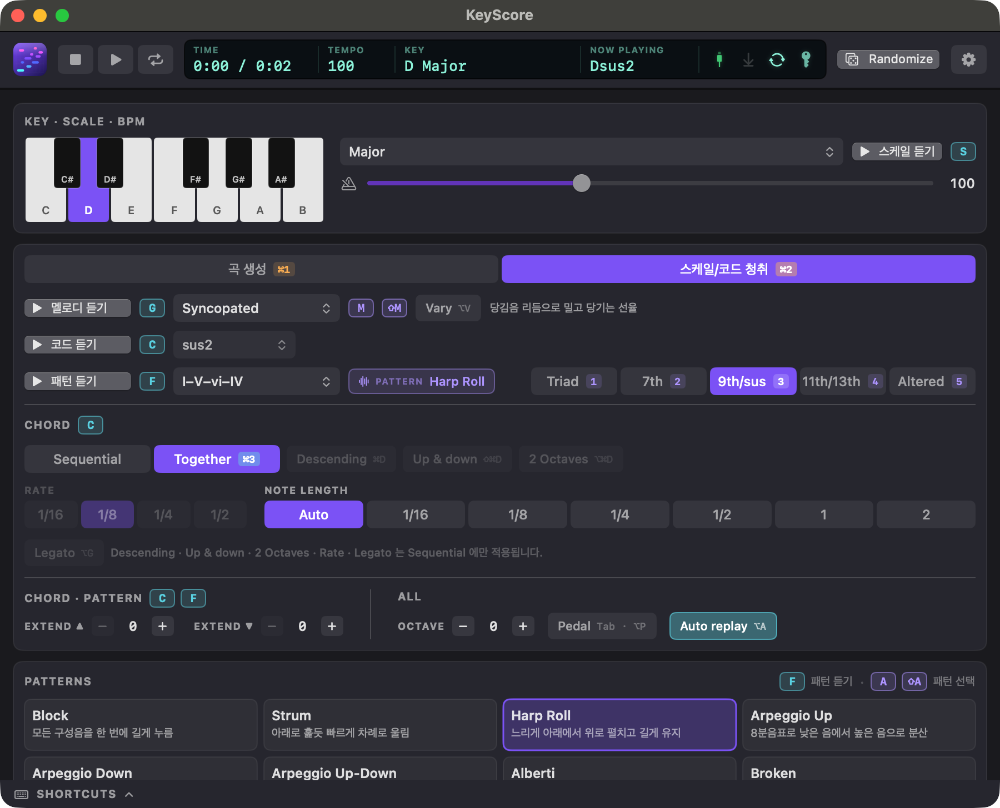

# KeyScore MIDI Generator

macOS 전용. OpenRouter LLM 으로 멜로디/코드 섹션을 만들고, CoreMIDI 가상 소스 "KeyScore" 로 가상악기/외장악기에 송신한다.

## 실행
    swift run KeyScore            # 개발용
    Scripts/build-app.sh          # build/KeyScore.app (아이콘 포함)
    Scripts/build-dist.sh [--force]  # dist/KeyScore-<버전>.dmg (배포용, build-app.sh 포함)

Swift 6 언어 모드(swift-tools-version 6.0), macOS 14 이상. 동시성 설계는 docs/decisions 참고.

- API key: 환경변수 OPENROUTER_API_KEY 또는 설정(⌘,)에서 입력(Keychain 저장).
- 모델: 설정에서 저가 모델 프리셋(Claude Haiku 5.5, GPT-6 Luna, DeepSeek, GLM, Qwen)을 고르거나 ID 를 직접 입력. 환경변수 OPENROUTER_MODEL 이 있으면 우선.
- 가상악기/외장악기: MIDI 입력 소스에서 "KeyScore" 선택. 기본 채널은 Melody 1, Chord 2, Bass 3, Second 4, Rhythm 10 (설정에서 1~16 변경, Second·Rhythm 은 곡 생성 탭에서도 변경).
- Second 파트(4번 채널): Riff 로 생성하면 LLM 이 섹션마다 1~2마디 리프를 쓰고, 앱은 멜로디가 쉬는 마디와 멜로디가 없는 간주 섹션에만 리프를 놓는다.
- Rhythm(10번 채널): 드럼은 앱이 General MIDI 노트로 연주한다. 리듬이 켜져 있으면 LLM 에 그루브를 알려 멜로디에 반영하고, 섹션마다 강약(none/light/full)과 필인 여부만 받는다. 크래시는 앞 섹션보다 세지거나 필인 뒤에만 친다.
- FORM: 곡은 intro(처음 한 번) · loop(길이만큼 반복) · outro(끝에 한 번)로 전개한다. 남는 길이는 loop 의 뒷부분(후렴 쪽)으로 채운다. 구성은 Free(AI) / A-B-간주-후렴 / Verse-Chorus / AABA 중에서 고르며, 섹션 역할(verse, prechorus, break, chorus …)에 따라 드럼 편성 기본값이 정해진다.
- 상단 디스플레이 아이콘: MIDI 출력(노트가 나갈 때 깜빡임), 서스테인 페달, 자동 재생, API key 상태. 마우스를 올리면 설명이 나온다.

## 구조
- LLM 은 섹션과 form 만 JSON 으로 생성, Arranger 가 목표 길이(30초~12분, 30초 단위)에 맞춰 전개.
- 생성은 단계별 호출로 쌓는다: 화음(form · 코드) → 베이스 · 리듬 → 멜로디(+리프). 뒤 단계는 앞 단계 결과(코드 타임라인과 구성음, 베이스 라인, 드럼 편성)를 보고 작곡한다.
  리듬이 켜져 있으면 Four on the Floor · Funk · Bossa · Shuffle 은 리듬을 먼저 정해 베이스를 킥에 맞추고, Rock · Ballad 는 베이스를 먼저 짜서 드럼 편성을 베이스에 맞춘다.
- 스케일/코드/진행/멜로디 패턴 청취는 LLM 없이 로컬에서 즉시 재생.
- MIDI 송신(MidiPlayer)은 전용 userInteractive 큐에서 다음 이벤트 시각에 맞춘 one-shot 타이머로 깨어난다 (폴링 없음).
  LLM 이 준 수치는 파싱 단계에서 유한성 검사와 범위 클램프를 거치고, 섹션 수와 form 길이에도 상한이 있다.
- API key 는 설정에서 입력한 값만 Keychain 에 저장한다. 환경변수로 받은 키는 저장하지 않는다.

## 단축키
메뉴바(재생 / 청취 / 곡 설정)에 모두 표시된다. 평문 키는 텍스트 입력 중에는 동작하지 않는다. 한글 입력기에서도 동작한다.

| 동작 | 키 |
|---|---|
| 재생/정지 | Space |
| 반복 | ⌥L |
| 곡 생성 / 생성 취소 / Randomize / Randomize + 청취 옵션 | ⌘G / ⌘. / ⌘R / ⇧⌘R |
| 설정 패널 | ⌘, (또는 상단 ⚙) |
| 하단 단축키 패널 열기/닫기 | ⌘/ (Help ▸ 단축키 안내, 패널 우측 상단 ✕) |
| 탭: 곡 생성 / 청취 | ⌘1 / ⌘2 |
| 스케일 / 코드 / 패턴(코드 진행) / 멜로디 듣기 | S / C / F / G |
| 서스테인 페달 | Tab 을 누르는 동안 (⌥P 로 고정) |
| 스케일 / 코드 종류 / 코드 진행: 다음 선택 | ⇧S / ⇧C / ⇧F |
| 스케일 / 코드 종류 / 코드 진행: 이전 선택 | ⌥⇧S / ⌥⇧C / ⌥⇧F |
| 템포 −/+ (Shift 는 5) | H / L (← / →) |
| Key +/− 반음 | K / J (↑ / ↓) |
| Scale 이전/다음 | [ / ] |
| 복잡도 (Triad · 7th · 9th/sus · 11th/13th · Altered) | 1 – 5 |
| 곡 길이 | , / . |
| 패턴 다음 / 이전 | A / ⇧A |
| 멜로디 패턴 다음 / 이전 | M / ⇧M |

## 청취 옵션
kornflake 의 Audition 옵션을 차용했다. 옵션마다 적용되는 듣기가 달라 청취 탭에서도 적용 대상별로 묶어 두었다.
스케일 듣기는 옵션과 무관하게 한 옥타브를 1/8 순차로 올라갔다 내려온다 (꼭대기 음은 한 번만). 옥타브만 따른다.

| 옵션 | 키 | 스케일 S | 코드 C | 패턴 F | 멜로디 G |
|---|---|:-:|:-:|:-:|:-:|
| Sequential / Together | ⌘3 | | ✓ | | |
| Descending | ⌘D | | ✓ | | |
| Up & down | ⇧⌘D | | ✓ | | |
| 2 Octaves | ⌥⌘D | | ✓ | | |
| Rate (진행 간격) | | | ✓ | | |
| Note Length (음 길이) | ⌘= / ⌘- | | ✓ | | |
| Legato | ⌥G | | ✓ | | |
| Extend ▲ / ▼ (코드 위/아래 확장) | ⌘U / ⇧⌘U, ⌘B / ⇧⌘B | | ✓ | ✓ | |
| Octave | ⌥⌘↑ / ↓ | ✓ | ✓ | ✓ | ✓ |
| Vary melody (들을 때마다 변주) | ⌥V | | | | ✓ |
| Pedal (서스테인) | Tab · ⌥P | ✓ | ✓ | ✓ | ✓ |
| Auto replay (값을 바꾸면 다시 재생) | ⌥A | ✓ | ✓ | ✓ | ✓ |

- Descending · Up & down · 2 Octaves · Rate · Legato 는 Sequential 에만 적용된다. Together 는 구성음을 한 번에 누른다.
- 패턴 듣기는 이 밖에 복잡도(1–5), 패턴(A / ⇧A), 코드 진행(⇧F)을 따른다. 멜로디 듣기는 멜로디 패턴(M / ⇧M)을 따른다.

## 테스트
    swift test
    KEYSCORE_LIVE=1 swift test --filter OpenRouterLiveTests   # 실제 API 호출 (KEYSCORE_DRUMS="Funk 16th", KEYSCORE_RIFF=1 선택)
